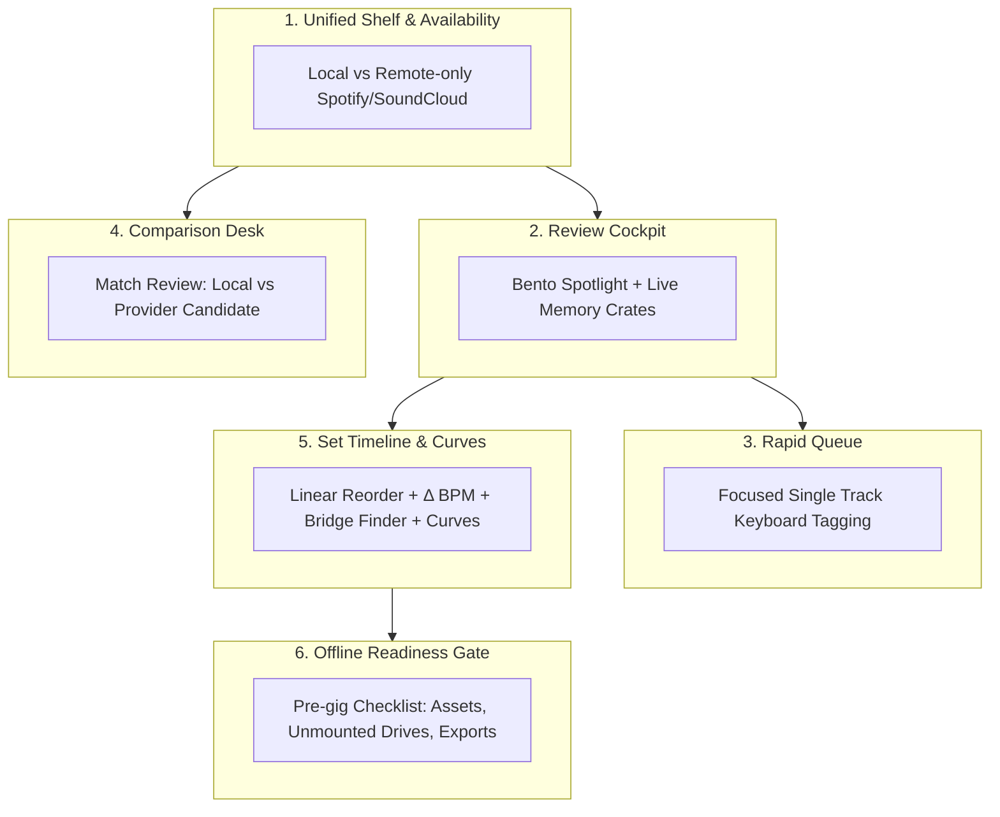

# CrateMind — Design System ("Psy Void Neon")

> **Specification & Visual Truth File (`DESIGN.md`)**  
> Πηγές Αλήθειας: [docs/README.md](file:///Volumes/6937130292/Projects/CrateMind/docs/README.md), [docs/ROADMAP_AND_IDEAS.md](file:///Volumes/6937130292/Projects/CrateMind/docs/ROADMAP_AND_IDEAS.md), [frontend/src/index.css](file:///Volumes/6937130292/Projects/CrateMind/frontend/src/index.css), [frontend/src/components/](file:///Volumes/6937130292/Projects/CrateMind/frontend/src/components/), [frontend/src/lib/](file:///Volumes/6937130292/Projects/CrateMind/frontend/src/lib/)  
> Τεχνολογικό Stack: React + Tailwind CSS v4 + shadcn/ui + OKLCH Colors + Framer Motion / GSAP

---

## 1. Product Identity & Operating Model

### Ταυτότητα Προϊόντος
- **Όνομα:** `CrateMind`
- **Tagline:** *Local-first personal DJ intelligence layer.*
- **Lead Feature (Κυρίαρχη λειτουργία README):** **DJ Taste Metadata & Memory Crates**. Το CrateMind οργανώνει τη μουσική όχι με βάση άκαμπτους φακέλους, αλλά με βάση την προσωπική DJ αισθητική (ενέργεια, σκοτεινότητα, ρόλος στο set, κατάσταση κομματιού) και ζωντανές ουρές αναθεώρησης (Review Queues).
- **Αρχιτεκτονικά Όρια Ασφάλειας (Strict Non-Destructive):**
  - **Owns taste metadata only:** Δεν αγγίζει beatgrids, cue points ή βάσεις δεδομένων άλλων DJ εφαρμογών (Serato, Rekordbox, Traktor).
  - **Zero file mutation:** Ποτέ δεν διαγράφει, δεν μετονομάζει και δεν τροποποιεί τα πρωτογενή αρχεία ήχου.
  - **Safe outputs:** Τα exports γράφονται αποκλειστικά σε φακέλους εξόδου (M3U8, CSV, JSON backup, Markdown).
  - **Autonomous Backups:** Αυτόματη δημιουργία αντιγράφων ασφαλείας της βάσης SQLite στο `data/backups/` σε κάθε εκκίνηση.

### Το Λειτουργικό Μοντέλο των 3 Ερωτημάτων (The 3 Foundational Questions)
Κάθε οθόνη και στοιχείο διεπαφής του CrateMind απαντά σε τρία θεμελιώδη ερωτήματα για κάθε μουσική εγγραφή:
1. **Τι είναι αυτό; (What is this?)**  
   Ταυτότητα ηχογράφησης/έκδοσης και αποδεικτικά στοιχεία προέλευσης (τοπικό αρχείο, SoundCloud, Spotify, version tokens: remix, extended, live, edit, remaster, DJ mix).
2. **Τι σημαίνει για μένα; (What does it mean to me?)**  
   Προσωπική αξιολόγηση: Likes, DJ αξιολογήσεις γούστου (energy/darkness 1-10), σημειώσεις μετάβασης, ρόλος στο set, ιστορικό ανακαλύψεων και συμμετοχή σε συλλογές.
3. **Τι μπορώ να κάνω με αυτό τώρα; (What can I do with it now?)**  
   Άμεση αναπαραγωγή τοπικού αρχείου, άνοιγμα εξωτερικής σελίδας υπηρεσίας, έλεγχος σύγκρισης υποψήφιας ταύτισης, ή εξαγωγή/δημοσίευση επιλεγμένης συλλογής.

---

## 2. The Dual-Axis Model: Personal Value vs Public Exposure

Το CrateMind διαχωρίζει ρητά την αξιολόγηση ενός κομματιού σε **δύο ανεξάρτητους άξονες**:
1. **Προσωπική Αξία (Personal Value):**  
   Κατάσταση (`approved`, `weapon`), ενέργεια, σκοτεινότητα, ρόλος στο set, τοπικός αριθμός αναπαραγωγών (`play_count`), ιστορικό live χρήσης (`last_played_at`).
2. **Παρατηρούμενη Δημόσια Έκθεση (Observed Public Exposure):**  
   Πραγματικά μετρικά SoundCloud (`playback_count`, `likes_count`, `reposts_count`), ημερομηνία παρατήρησης και λογαριασμός προέλευσης.

### Βασικές Προβολές 2 Αξόνων (Shelf Views)
- **"Υψηλή προσωπική αξία, χαμηλή έκθεση" (Secret Underground Weapons):**  
  Κομμάτια δοκιμασμένα (`status:weapon` ή `approved`), με υψηλό rating αλλά ελάχιστα SoundCloud plays.
- **"Γνώριμες άγκυρες" (Familiar Anchors):**  
  Κομμάτια υψηλής αναγνωρισιμότητας για σταθεροποίηση του dancefloor.
- **"Ξεχασμένα αγαπημένα" (Forgotten Favorites):**  
  `status:approved not_recent:90` (Εγκεκριμένα tracks χωρίς πρόσφατη αναπαραγωγή).
- **"Χωρίς αξιολόγηση" (Not Yet Judged):**  
  `untagged` tracks που περιμένουν στο Tagging Queue.

---

## 3. Atmosphere & Visual Vibe: "Psy Void Neon"

- **Μόνιμα Σκοτεινό Cockpit (`color-scheme: dark`):** Δεν υπάρχει light mode. Η διεπαφή προσομοιώνει ένα επαγγελματικό DJ booth / sci-fi cockpit με σκοτεινό υπόβαθρο βαθύ ιντιγκο/βιολετί.
- **Glassmorphism & Βάθος:** Ημιδιαφανείς επιφάνειες με `backdrop-filter: blur(14px) saturate(1.3)`, λεπτά περιγράμματα hairline (`1px solid oklch(... / 0.14)`), και εσωτερικά highlights (`inset`).
- **Aurora Glows & Accents:** Φωτεινές ανταύγειες νέον (Cyan, Chartreuse, Violet, Magenta, Amber, Rose) σε χρωματικό χώρο OKLCH για μέγιστη καθαρότητα και αρμονική αντίθεση.
- **Spotlights & Electric Borders:** Διαδραστικά εφέ φωτισμού που ακολουθούν τον κέρσορα ([`BentoSpotlight`](file:///Volumes/6937130292/Projects/CrateMind/frontend/src/components/ui/BentoSpotlight.tsx), [`GlassCard`](file:///Volumes/6937130292/Projects/CrateMind/frontend/src/components/ui/GlassCard.tsx)) και ηλεκτρικά περιγράμματα canvas procedural noise ([`ElectricBorder`](file:///Volumes/6937130292/Projects/CrateMind/frontend/src/components/ElectricBorder.tsx)).

---

## 4. Color Tokens & Theme Architecture

Όλα τα χρώματα ορίζονται στο [frontend/src/index.css](file:///Volumes/6937130292/Projects/CrateMind/frontend/src/index.css) με χρήση `oklch()`.

### Επιφάνειες (Surfaces) — Void Palette
| Token | OKLCH Τιμή | Ρόλος & Χρήση |
|---|---|---|
| `--color-cm-bg` | `oklch(0.12 0.028 274)` | Κύριο βαθύ φόντο (Deep void canvas) |
| `--color-cm-bg-2` | `oklch(0.16 0.038 274)` | Φόντο δευτερεύοντος επιπέδου / Sidebar |
| `--color-cm-panel` | `oklch(0.20 0.040 274)` | Ανυψωμένες κάρτες & πάνελ (Cards, Modals) |
| `--color-cm-panel-2` | `oklch(0.24 0.045 274)` | Υπερυψωμένα στοιχεία (Popovers, Tooltips, Dialogs) |
| `--color-cm-line` | `oklch(0.80 0.06 250)` | Λεπτά διαχωριστικά γραμμών (Hairline dividers) |

### Κείμενο & Μελάνι (Ink)
| Token | OKLCH Τιμή | Ρόλος & Χρήση |
|---|---|---|
| `--color-cm-text` | `oklch(0.97 0.012 270)` | Πρωτεύον κείμενο υψηλής αντίθεσης (Primary ink) |
| `--color-cm-muted` | `oklch(0.77 0.026 272)` | Δευτερεύον κείμενο / επεξηγήσεις (Muted ink) |
| `--color-cm-faint` | `oklch(0.60 0.028 274)` | Τριτεύον κείμενο / placeholders / απενεργοποιημένα |

### Νέον Χρωματικοί Τόνοι (Accents & Semantics)
| Token | OKLCH Τιμή | Semantic Ρόλος & Εφαρμογή |
|---|---|---|
| `--color-cm-cyan` | `oklch(0.82 0.16 205)` | **Primary Accent:** Ενέργειες, Focus rings, Spotlight, Κατάσταση `approved` |
| `--color-cm-chartreuse`| `oklch(0.88 0.20 128)` | **Success / Energy:** Κατάσταση `weapon`, Υψηλή ενέργεια, Αρμονικό ταίριασμα |
| `--color-cm-violet` | `oklch(0.70 0.20 300)` | **Tertiary / Depth:** Σκοτεινότητα (gradient end), Φίλτρο `forgotten` |
| `--color-cm-blue` | `oklch(0.70 0.17 252)` | **Secondary:** Κατάσταση `testing`, Σκοτεινότητα (gradient start) |
| `--color-cm-magenta` | `oklch(0.72 0.23 340)` | **Highlight:** Φίλτρο `never_played`, Έκτακτη επισήμανση |
| `--color-cm-amber` | `oklch(0.85 0.16 78)` | **Warning:** Καταστάσεις `needs_review`, `overplayed`, Μεγάλα BPM jumps |
| `--color-cm-rose` | `oklch(0.71 0.21 18)` | **Destructive:** Κατάσταση `avoid`, Σφάλματα, Επικίνδυνα tracks |

### Glass & Utility Properties
```css
/* Glassmorphism */
--cm-glass: oklch(0.20 0.040 274 / 0.62);         /* blur(14px) saturate(1.3) */
--cm-glass-strong: oklch(0.24 0.045 274 / 0.82);  /* blur(18px) saturate(1.4) */
--cm-border: oklch(0.82 0.07 250 / 0.14);
--cm-border-hi: oklch(0.85 0.10 250 / 0.28);

/* Glow Utilities */
.glow-cyan       { box-shadow: 0 0 0 1px oklch(0.82 0.16 205 / 0.4), 0 0 24px -4px oklch(0.82 0.16 205 / 0.5); }
.glow-chartreuse { box-shadow: 0 0 0 1px oklch(0.88 0.20 128 / 0.4), 0 0 24px -4px oklch(0.88 0.20 128 / 0.5); }
.glow-magenta    { box-shadow: 0 0 0 1px oklch(0.72 0.23 340 / 0.4), 0 0 24px -4px oklch(0.72 0.23 340 / 0.5); }
.glow-violet     { box-shadow: 0 0 0 1px oklch(0.70 0.20 300 / 0.4), 0 0 24px -4px oklch(0.70 0.20 300 / 0.5); }
```

---

## 5. Typography & Numerics

1. **Κύρια Γραμματοσειρά (Sans):**  
   `"Inter Variable", ui-sans-serif, system-ui, sans-serif`
2. **Μονοδιάστατη Γραμματοσειρά (Mono):**  
   `"JetBrains Mono", ui-monospace, "SF Mono", monospace`  
   **Υποχρεωτική** για κάθε τεχνική ή αριθμητική ένδειξη:
   - BPM (`148.0 BPM`)
   - Camelot Key (`8A`, `11B`)
   - Μετρικά (`tabular-nums font-mono`)
   - Χρονικές διαρκείς (`05:32`)
   - Φίλτρα αναζήτησης και tokens (`status:approved`)

---

## 6. Native Shapes: Τα 6 Δομικά Σχήματα της Εφαρμογής



### 1. The Unified Source & Availability Shelf
- **Πολιτική Remote-only:** Ένα κομμάτι Spotify ή SoundCloud που υπάρχει μόνο απομακρυσμένα είναι έγκυρο μέλος του καταλόγου. Δεν είναι χαλασμένο τοπικό αρχείο ούτε απαίτηση άμεσου download.
- **Καταστάσεις Διαθεσιμότητας (`availabilityLabels`):**
  - `LOCAL_PLAYABLE` → **Τοπικό**
  - `LOCAL_AND_REMOTE` → **Τοπικό + πηγές**
  - `LOCAL_MISSING_FILE` → **Τοπική διαδρομή μη διαθέσιμη**
  - `REMOTE_ONLY_SOUNDCLOUD` → **SoundCloud — χωρίς αποδεκτή τοπική σύνδεση**
  - `REMOTE_ONLY_SPOTIFY` → **Spotify — χωρίς αποδεκτή τοπική σύνδεση**
  - `REMOTE_ONLY_BOTH` → **SoundCloud + Spotify — χωρίς αποδεκτή τοπική σύνδεση**
  - `REMOTE_UNRESOLVED` → **Ανεπίλυτη διαθεσιμότητα**
- **Διαγνωστικά Απουσίας Αρχείου (`fileCauseLabels`):**  
  Ρητή διάκριση ανάμεσα σε `root_unmounted` (αποσυνδεδεμένος εξωτερικός δίσκος / απουσία ανεπιβεβαίωτη) και `recorded_path_absent` (διαγραμμένο αρχείο σε προσβάσιμο φάκελο).

### 2. The Review Cockpit & Memory Crates (Dashboard)
- **Bento Grid με `BentoSpotlight`:** Ζωντανές κάρτες ανασκόπησης:
  - *Όπλα* (Flagship: chartreuse glow, trophy icon)
  - *Ξεχασμένα εγκεκριμένα* (`status:approved not_recent:90`)
  - *Εγκεκριμένα που δεν παίχτηκαν* (`status:approved never_played`)
  - *Νέα χωρίς tags* (`untagged` → άμεση μετάβαση στο Tagging Queue)
  - *Υποψήφια με μεγάλα breaks* (`break:long`)
  - *Διπλότυπα* (Duplicates review)

### 3. The Match Review Comparison Desk
- **Μορφή:** Side-by-side γραφείο σύγκρισης ([SoundCloudReviewDrawer.tsx](file:///Volumes/6937130292/Projects/CrateMind/frontend/src/components/SoundCloudReviewDrawer.tsx)).
- **Στοιχεία:** Τοπικό αρχείο & raw tags vs Υποψήφιος τίτλος/uploader/διάρκεια, διαφορά διάρκειας (`duration delta`), version tokens (remix, extended, live), και λόγοι πρότασης.
- **Ενέργειες:** Γρήγορη αποδοχή (`accept`), απόρριψη (`reject`), παράλειψη (`skip`). Ακρόαση τοπικού ήχου και link στην αυθεντική σελίδα της υπηρεσίας.

### 4. The Drag-and-Drop Set Timeline (Set Builder)
- **Μορφή:** Κάθετη σειριακή χρονική λωρίδα με Framer Motion Reorder ([SetTimeline.tsx](file:///Volumes/6937130292/Projects/CrateMind/frontend/src/components/SetTimeline.tsx)).
- **Μεταβάσεις:**
  - Δείκτες απόκλισης BPM μεταξύ γειτονικών κομματιών (`Δ BPM`, chip tone: `chartreuse` για <=3, `cyan` για <=8, `amber` για >8).
  - Κουμπί **Bridge Finder (Γέφυρα)** ανάμεσα σε δύο tracks.
  - Pair Notes Memory (καταγραφή σημειώσεων επιτυχημένης μετάβασης).
- **Καμπύλες:** SVG sparklines εξέλιξης σε πραγματικό χρόνο για **BPM**, **Ενέργεια** και **Σκοτεινότητα** ([Curve.tsx](file:///Volumes/6937130292/Projects/CrateMind/frontend/src/components/Curve.tsx)).

### 5. Collection Algebra & Family Browser
- **Πράξεις Συνόλων ([CollectionAlgebra.tsx](file:///Volumes/6937130292/Projects/CrateMind/frontend/src/components/CollectionAlgebra.tsx)):**
  - `union` → **Ένωση**
  - `intersection` → **Τομή**
  - `difference` → **Αριστερή μείον δεξιά**
  - Επιλογή `exclude_playable` (αφαίρεση όσων παίζουν ήδη τοπικά).
- **Μετρικά Επικάλυψης:** Jaccard % (`% κοινό περιεχόμενο`), κοινές, μόνο αριστερά, μόνο δεξιά.
- **Collection Families:** Διατήρηση snapshot ιστορικού (drafts vs finals), χωρίς αυθαίρετη αντικατάσταση παλαιότερων εκδόσεων.

### 6. The Offline Set Readiness Gate
- **Pre-gig Έλεγχος:** Πριν από κάθε εμφάνιση, η οθόνη ελέγχει:
  - Παρουσία τοπικών αρχείων (έλεγχος mounted δίσκων).
  - Ανεπίλυτες ταυτότητες ή αμφίβολα remixes.
  - Επαλήθευση BPM & key.
  - Ετοιμότητα εξαγωγής (M3U8 / Rekordbox XML / CSV).

---

## 7. Real Terminology & Canonical Schema

*100% αυθεντική ορολογία απευθείας από τον κώδικα:*

### Κατάσταση Κομματιού (Track Status)
| Τιμή (Code) | Ελληνική Ετικέτα | Chip Tone | Σημασία |
|---|---|---|---|
| `unknown` | άγνωστο | `muted` | Χωρίς προσωπική αξιολόγηση |
| `needs_review` | έλεγχος | `amber` | Χρειάζεται ακρόαση / επαλήθευση |
| `testing` | δοκιμή | `blue` | Υπό δοκιμή σε DJ sets |
| `approved` | εγκεκριμένο | `cyan` | Επιβεβαιωμένο για χρήση σε set |
| `weapon` | όπλο | `chartreuse` + glow | Κορυφαίο κομμάτι εγγυημένης αντίδρασης |
| `overplayed` | πολυπαιγμένο | `amber` | Έχει παιχτεί υπερβολικά συχνά |
| `retired` | αποσυρμένο | `muted` | Αρχειοθετημένο / εκτός rotation |
| `avoid` | απόφυγε | `rose` | Ακατάλληλο / απορριφθέν |

### Ρόλοι στο Set (Set Roles)
- `builder` → **χτίσιμο**
- `bridge` → **γέφυρα**
- `peak` → **κορύφωση**
- `reset` → **reset**
- `closer` → **κλείσιμο**
- `afterhours` → **afterhours**
- `afterglow` → **afterglow**

### Διαστάσεις Γούστου (Taste Dimensions)
- **Ενέργεια (`energy`):** Κλίμακα 1–10 (Οπτικοποίηση: Cyan → Chartreuse gradient meter)
- **Ένταση (`intensity`):** Κλίμακα 1–10
- **Σκοτεινότητα (`darkness`):** Κλίμακα 1–10 (Οπτικοποίηση: Blue → Violet gradient meter)
- **Μελωδία (`melody`):** Κλίμακα 1–10
- **Ιδιορρυθμία (`weirdness`):** Κλίμακα 1–10
- **Χάος (`chaos_level`):** Κλίμακα 1–10
- **Mixability (`mixability`):** Κλίμακα 1–5
- **Σιγουριά (`confidence`):** Κλίμακα 1–5

### Υποείδη & Breakdowns (Substyles & Profiles)
- **Substyles:** `prog-psy`, `full-on`, `forest`, `darkpsy`, `hi-tech`, `psycore`, `suomi`, `zenonesque`.
- **Breakdown Profiles:** `no break` (χωρίς break), `short break` (σύντομο break), `long melodic break` (μεγάλο μελωδικό break), `fakeout` (fakeout), `cinematic` (κινηματογραφικό).
- **BPM Jump Tolerance:** `native` (φυσικό), `can_push_up` (ανεβαίνει), `can_push_down` (κατεβαίνει), `do_not_warp` (χωρίς warp), `huge` (μεγάλο).
- **Transition Flags:**
  - `can_cut_into` (δέχεται cut-in)
  - `can_cut_out_of` (βγαίνει με cut-out)
  - `dramatic` (`dramatic_transition_candidate` / δραματική μετάβαση)

### Background Jobs
- `scan` → scan βιβλιοθήκης
- `fingerprint` → ακουστικό αποτύπωμα (Chromaprint/fpcalc)
- `duplicate_scan` → εντοπισμός διπλοτύπων
- `analyze` → ανάλυση BPM + key (Essentia, ReccoBeats, GetSongBPM, Cyanite)
- `artist_enrich` → εμπλουτισμός καλλιτεχνών

---

## 8. Solar Void (Light Theme)

### Philosophy
Solar Void is the daylight counterpart of Night Void: high-glare booth and studio ergonomics for sunlit rooms, laptop screens on festival grounds, and morning sets. Surfaces are icy quartz and chilled aluminium — never warm beige, never generic enterprise grey. The psytrance pulse survives the sun by **inverting the neon**: electric energy is expressed as high-density ionized ink (deeply saturated, dark-value accents) and frosted acrylic bevels, instead of background glow halos.

Rules of the inversion:
- Glow becomes **bevel + dispersion**: crisp white inset highlight on top, faint dark hairline boundary, soft wide ambient shadow. No neon drop-glow.
- Accents keep their psytrance chroma but drop in lightness so they pass WCAG AA against quartz surfaces (≥ 4.5:1 for text, ≥ 3:1 for UI strokes and meters).
- The page stays calm and near-white; colour appears only as dense ink, tinted chips, and energetic playheads.

### Light-mode Token Table

| Token | Solar Void Value | Role |
| --- | --- | --- |
| `--cm-bg` | `oklch(0.97 0.012 274)` | Tinted quartz page field |
| `--cm-bg-2` | `oklch(0.99 0.008 274)` | Rails, sidebar, transport bar |
| `--cm-panel` | `oklch(0.99 0.008 274 / 0.85)` | Frosted acrylic card body |
| `--cm-panel-2` | `oklch(1 0 0 / 0.92)` | Raised / strong glass |
| `--cm-line` | `oklch(0.32 0.045 274)` | Hairline stroke base (used at 8–20% alpha) |
| `--cm-text` | `oklch(0.18 0.035 274)` | Deep ink primary text |
| `--cm-muted` | `oklch(0.42 0.032 274)` | Secondary text |
| `--cm-faint` | `oklch(0.54 0.028 274)` | Labels, units, meta |
| `--cm-cyan` | `oklch(0.55 0.22 230)` | Electric cobalt-cyan — primary action & focus |
| `--cm-chartreuse` | `oklch(0.52 0.18 140)` | Weapon / high energy / success |
| `--cm-violet` | `oklch(0.49 0.25 300)` | Depth, darkness, key metadata |
| `--cm-blue` | `oklch(0.50 0.22 258)` | Testing / informational |
| `--cm-magenta` | `oklch(0.52 0.26 340)` | Rare accent, artwork ramps |
| `--cm-amber` | `oklch(0.56 0.15 70)` | Review / warning |
| `--cm-rose` | `oklch(0.54 0.22 20)` | Destructive / avoid |
| `--cm-glass` | `oklch(0.99 0.008 274 / 0.85)` | Glass fill |
| `--cm-glass-strong` | `oklch(1 0 0 / 0.92)` | Strong glass fill |
| `--cm-border` | `oklch(0.18 0.035 274 / 0.08)` | Dark boundary stroke |
| `--cm-border-hi` | `oklch(0.55 0.22 230 / 0.35)` | Active / hover stroke |
| `--cm-shadow-panel` | `0 1px 2px oklch(0.30 0.05 274 / 0.06), 0 18px 44px oklch(0.45 0.06 274 / 0.14), inset 0 1px 0 oklch(1 0 0 / 0.85)` | Dual-layer bevel + dispersed ambient shadow |
| `--cm-spotlight` | `oklch(0.55 0.22 230 / 0.10)` | Card cursor spotlight |
| `--cm-spotlight-wide` | `oklch(0.55 0.22 230 / 0.07)` | Grid cursor spotlight |
| `--cm-track` | `oklch(0.18 0.035 274 / 0.12)` | Unfilled meter / waveform track |
| `--cm-aurora-opacity` | `0.05` | Ambient aurora intensity |

### Component Rules in Light Mode
- **GlassCard / GlassPanel:** Frosted acrylic: `bg-cm-panel/60` + `backdrop-blur-xl`, dark boundary border (`border-cm-line/15`) και `.cm-surface` shadow με inset specular highlight (`inset 0 1px 0 rgba(255,255,255,0.8)`). Ποτέ κάρτες μέσα σε κάρτες. Ποτέ έγχρωμο glow αντί για bevel.
- **Waveform & Meters:** Οι μπάρες σχεδιάζονται με πλήρες accent chroma πάνω στη ράγα `--cm-track`, ώστε η περιοχή αναπαραγωγής να διαβάζεται ως πυκνή κεφαλή ιονισμένου μελανιού.
- **Badges & Chips:** Υπόβαθρο κορεσμένου παστέλ τόνου (accent στο ~12% alpha), περίγραμμα στο χρώμα του accent και πυκνή τυπογραφία έγχρωμου μελανιού. Κείμενο πάντα uppercase, 10px, semibold.
- **Buttons:** Το primary χρησιμοποιεί το cobalt-cyan γέμισμα με `text-cm-bg` (quartz) για αντίθεση AA. Το secondary είναι strong glass με σκούρα hairline γραμμή. Το focus διατηρεί πάντα το cyan ring και στα δύο θέματα.
- **Ambient Aurora:** Στο Solar Void η aurora πέφτει σε `--cm-aurora-opacity: 0.05` — αποτελεί ατμόσφαιρα, όχι πηγή φωτός.

### Theme Switching Convention
Τα tokens είναι CSS custom properties. Τα Tailwind utilities (`bg-cm-bg`, `text-cm-text`, `border-cm-line/15`) αντιστοιχίζονται σε αυτά μέσω `@theme inline`. Η αλλαγή θέματος είναι μία απλή εγγραφή attribute στο `<html>` χωρίς re-render:

```ts
document.documentElement.setAttribute("data-theme", "light"); // or "dark"
```

- `:root, [data-theme="dark"]` — Night Void (default).
- `[data-theme="light"], .light` — Solar Void.
- Αποθήκευση στο `localStorage` υπό το κλειδί `cratemind-theme` (default: `dark`).
- Το component `ThemeToggle` υλοποιεί αυτή τη σύμβαση.

